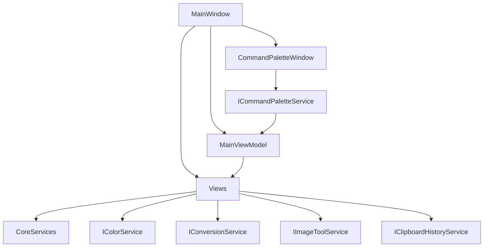

# SystemToolkit v1.4 技术设计

Feature Name: toolkit-v1.4
Updated: 2026-11-26

## 描述

在现有 Core/App 分层上新增五组能力：颜色工具、格式转换中心、图片批量处理、剪贴板历史、命令面板。全部遵循既有约定：服务接口放 `SystemToolkit.Core/Services`，数据模型放 `SystemToolkit.Core/Models`，视图为代码构建的 `UserControl`，通过 `App.xaml.cs` 注册到 DI，菜单在 `MainViewModel` 声明。

## 架构

## 组件与接口

| 组件 | 职责 | 平台约束 |
|---|---|---|
| `IColorService` | 颜色解析与多格式互转、WCAG 对比度、调色板生成 | 纯托管，跨平台 |
| `IConversionService` | YAML/JSON 互转、JSONPath、Markdown 转 HTML、二维码、图片 Base64 | 纯托管，跨平台 |
| `IImageToolService` | 批量缩放与格式转换 | GDI+，仅 Windows 执行，尺寸计算跨平台 |
| `IClipboardHistoryService` | 历史条目去重、固定、搜索、裁剪 | 纯托管，跨平台 |
| `ICommandPaletteService` | 条目注册与打分排序检索 | 纯托管，跨平台 |
| `ColorToolView` | 颜色工作台与屏幕取色 | 取色按钮仅 Windows 启用 |
| `ConversionView` | 五个转换子页签 | 跨平台 |
| `ImageBatchView` | 选择图片、设置参数、展示结果 | 非 Windows 禁用执行 |
| `ClipboardHistoryView` | 监听、搜索、复制、固定、删除 | 监听仅 Windows |
| `CommandPaletteWindow` | Ctrl+K 搜索跳转 | 跨平台 |

## 数据模型

- `ColorInfo`：Hex/RGB/HSL/HSV/CMYK 全量表示
- `WcagContrastResult`：对比度与 AA/AAA 判定、推荐前景色
- `ColorPaletteResult`：互补/类似/三角/明度阶梯
- `ImageResizeOptions`、`ImageResizeItemResult`、`ImageResizeSummary`
- `ClipboardEntry`：内容、格式、字节数、固定标记、预览
- `CommandPaletteEntry`：标题、分类、关键词、得分

## 正确性属性

1. `FromRgb` 对 0-255 以外的分量抛 `ArgumentOutOfRangeException`
2. 颜色解析对无法识别的输入抛 `FormatException`，空输入抛 `ArgumentException`
3. HSL/HSV 与 RGB 转换在整数舍入范围内互相还原
4. WCAG 对比度范围 1.0 至 21.0，黑白组合取 21.0
5. YAML 标量按类型还原为 JSON 数值/布尔/null；带引号标量保留字符串
6. JSONPath 必须以 `$` 开头，非法表达式抛 `FormatException`
7. 图片缩放按最长边或百分比计算，比例误差不超过 1 像素
8. 剪贴板历史去重后置顶，固定项不被裁剪
9. 命令面板按精确标题 > 前缀 > 包含 > 分类/关键词 > 模糊子序列排序

## 错误处理

- Core 服务以异常表达失败，UI 捕获后写入状态栏文本，不弹崩溃对话框
- 图片批量处理逐项捕获异常，失败项记录 `Error` 字段，不中断整批
- 剪贴板读取被占用时静默跳过本轮轮询

## 测试策略

- xUnit + FluentAssertions，新增 5 个测试类共 83 个用例
- 依赖 Windows 的用例首行 `if (!OperatingSystem.IsWindows()) return;` 守卫
- 图片处理真实用例覆盖缩放尺寸、输出文件与体积统计
- 全量 396 项在 Linux 环境验证通过

## 依赖

| 包 | 版本 | 用途 | 许可 |
|---|---|---|---|
| Markdig | 1.6.0 | Markdown 转 HTML | BSD-2-Clause |
| YamlDotNet | 18.1.0 | YAML 解析与序列化 | MIT |
| QRCoder | 1.9.0 | 二维码 PNG 生成 | MIT |